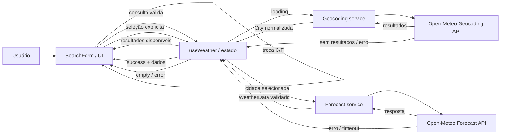

# Plano Técnico — Weather App

## 1. Visão Geral da Arquitetura

A aplicação será uma SPA React sem backend próprio no MVP. `components/` apresenta a interface; `hooks/` mantém o estado e orquestra busca, seleção, retry e previsão; `services/` realiza as requisições à Open-Meteo; `lib/` contém funções puras para validação, normalização, conversão, formatação e mapeamento; `types/` define contratos compartilhados. `App.tsx` compõe a tela, e `main.tsx` inicializa a aplicação no Vite.

```text
Usuário
  -> components / App.tsx
  -> hooks (estado e orquestração)
  -> services (requisições HTTP)
  -> Open-Meteo Geocoding / Forecast APIs
  -> lib (validação e normalização dos dados)
  -> hooks -> components (apresentação)

types/ define os contratos compartilhados entre essas camadas.
```

Manter acesso HTTP separado das funções puras permite substituir ou simular o provedor e testar regras meteorológicas sem renderizar React; a normalização na fronteira impede que respostas incompletas quebrem a apresentação (NFR05, NFR06, NFR18, NFR19).

## 2. Stack Técnica

| Tecnologia | Uso e justificativa | Requisitos relacionados |
|---|---|---|
| TypeScript strict | Contratos explícitos para dados externos e internos; reduz estados inválidos. | NFR06, NFR19 |
| React 19 + Vite | SPA responsiva e ambiente já configurado no repositório. | RF18–RF22, NFR12–NFR14 |
| Tailwind CSS | Estilização responsiva consistente com a stack existente. | AC07.1, AC07.4, NFR07, NFR12 |
| Open-Meteo Geocoding + Forecast | Busca e previsão sem chave de API, conforme escopo do MVP. | RF02, RF07, NFR18, NFR20 |
| Vitest + Testing Library | Testes rápidos de funções puras e comportamento acessível dos componentes. | NFR19–NFR21 |
| Playwright | Validação dos fluxos integrados em navegador e viewports representativos. | AC07.1–AC07.4, NFR14, NFR21 |
| Biome | Lint e verificações já disponíveis no projeto. | NFR21 |

## 3. Estrutura do Projeto

Estrutura-alvo para o código da aplicação; arquivos de configuração existentes permanecem na raiz.

```text
src/
  components/
    SearchForm.tsx           # Entrada e submissão manual da busca
    CityResults.tsx          # Resultados acessíveis para seleção explícita
    CurrentWeatherPanel.tsx  # Condições atuais e referência temporal
    ForecastList.tsx         # Cinco dias em ordem cronológica
    UnitToggle.tsx           # Seleção C/F
    StatusMessage.tsx        # Loading, erro, vazio e orientação inicial
  hooks/
    useWeather.ts            # Estado e orquestração de busca, previsão e retry
    useUnitPreference.ts     # Unidade ativa e preferência local
  services/
    openMeteo.ts             # Requisições Open-Meteo, timeout e status HTTP
  lib/
    weatherMapper.ts         # Validação e normalização de respostas
    weatherCode.ts           # Mapeamento puro de códigos WMO para pt-BR
    temperature.ts           # Conversão e formatação de temperaturas
    date.ts                  # Datas e rótulos no timezone da cidade
  types/
    weather.ts               # Contratos compartilhados de cidade e clima
  App.tsx
  main.tsx                   # Ponto de entrada da aplicação Vite
tests/
  unit/                     # Serviços, mapeamentos, datas e conversões
  components/               # Interações e estados acessíveis
  e2e/                      # Fluxos principais com APIs interceptadas
```

`services/` limita-se ao acesso de dados e traduz falhas de transporte em erros tratáveis; `lib/` concentra transformações determinísticas e funções puras; `types/` mantém os contratos internos distintos do formato externo, evitando propagar o JSON do provedor pela aplicação (NFR06, NFR18, NFR19). Os testes devem seguir a organização e os diretórios que forem efetivamente configurados no projeto.

## 4. Modelo de Dados

Contratos internos sugeridos; são descritos como campos e responsabilidades, não como implementação TypeScript. Campos marcados como opcionais podem não estar disponíveis na resposta e não devem ser inventados na UI (RF22).

### Unit

Representa a unidade de temperatura. Seus valores permitidos são `celsius` e `fahrenheit`, correspondentes a Celsius (°C) e Fahrenheit (°F). A unidade inicial é Celsius e deve ser consistente entre clima atual e previsão (RF14–RF16).

### City

Representa uma localidade retornada pela geocodificação e selecionável pelo usuário.

| Campo | Obrigatoriedade | Significado |
|---|---|---|
| `id` | Obrigatório | Identificador da localidade retornado pelo geocoding. |
| `name` | Obrigatório | Nome da cidade. |
| `country` | Opcional | País, quando retornado. |
| `latitude` | Obrigatório | Latitude usada na consulta meteorológica. |
| `longitude` | Obrigatório | Longitude usada na consulta meteorológica. |
| `admin1` | Opcional | Região ou estado, quando disponível. |
| `timezone` | Opcional | Fuso horário associado à localidade, se retornado pelo geocoding. |

### CurrentWeather

Representa as condições observadas no horário informado pelo provedor.

| Campo | Obrigatoriedade | Significado |
|---|---|---|
| `temperature` | Obrigatório | Temperatura atual armazenada em Celsius, unidade canônica dos dados recebidos. |
| `condition` | Obrigatório | Descrição meteorológica em pt-BR. |
| `weatherCode` | Interno/opcional | Código WMO para mapeamento; não exibir o código técnico ao usuário. |
| `measuredAt` | Obrigatório | Data e horário da medição retornados pelo provedor. |
| `relativeHumidityPercent` | Opcional; fora do MVP | Umidade relativa em porcentagem. |
| `windSpeedKmh` | Opcional; fora do MVP | Velocidade do vento em km/h. |
| `pressureHpa` | Opcional; fora do MVP | Pressão atmosférica em hPa. |
| `precipitationMm` | Opcional; fora do MVP | Precipitação em milímetros, conforme o período informado pela API. |
| `timezone` | Obrigatório | Fuso horário usado para interpretar a medição. |
| `timezoneAbbreviation` | Opcional | Abreviação do fuso, quando retornada. |

### ForecastDay

Representa um dia da previsão. A coleção em `WeatherData` contém exatamente cinco dias: hoje e os quatro seguintes no fuso horário da cidade (RF09, RF11).

| Campo | Obrigatoriedade | Significado |
|---|---|---|
| `date` | Obrigatório | Data civil local do dia previsto, em ordem cronológica. |
| `minimum` | Obrigatório para previsão válida | Temperatura mínima armazenada em Celsius, unidade canônica dos dados recebidos. |
| `maximum` | Obrigatório para previsão válida | Temperatura máxima armazenada em Celsius, unidade canônica dos dados recebidos. |
| `condition` | Obrigatório | Descrição da condição em pt-BR. |
| `weatherCode` | Interno/opcional | Código WMO para mapeamento, não exposto diretamente na UI. |
| `precipitationMm` | Opcional; fora do MVP | Precipitação diária em milímetros, se fornecida pelo provedor. |
| `isToday` | Obrigatório | Indica se a data corresponde ao dia atual no fuso da cidade. |

### WeatherData

Agrega o contexto geográfico e os dados meteorológicos normalizados de uma consulta.

| Campo | Obrigatoriedade | Significado |
|---|---|---|
| `city` | Obrigatório | Cidade selecionada. |
| `current` | Obrigatório | Dados de `CurrentWeather`. |
| `forecast` | Obrigatório | Lista cronológica de exatamente cinco itens `ForecastDay`. |
| `timezone` | Obrigatório | Fuso de referência dos dados e do cálculo de “Hoje”. |
| `timezoneAbbreviation` | Opcional | Abreviação do fuso retornada pelo provedor. |
| `utcOffsetSeconds` | Opcional | Deslocamento UTC retornado pelo provedor. |
| `fetchedAt` | Obrigatório | Instante em que a aplicação recebeu os dados. |

Nome e coordenadas são necessários para consultar a localidade (RF01–RF07); metadados geográficos são opcionais quando não retornados (RF03, RF22). Embora umidade, vento, pressão e precipitação estejam representados como campos opcionais para extensibilidade, permanecem fora do MVP conforme a spec; não são critérios de validação nem devem aparecer como dados esperados na interface. Antes de apresentar sucesso, validar os campos essenciais e a existência de cinco datas diárias utilizáveis (RF09, NFR06).

## 5. Fluxo de Dados



1. O usuário informa uma consulta e submete o formulário. A busca é manual; não há chamadas a cada tecla (RF01, NFR02).
2. A UI remove espaços externos, valida entrada não vazia e exige pelo menos dois caracteres. Entrada inválida não chama a API e mantém o texto editável (RF05, NFR15).
3. O hook inicia `searchStatus=loading` e chama o serviço de geocodificação. Resultados válidos são normalizados para `City`; lista vazia vira estado `empty`. Nenhum resultado é selecionado automaticamente (RF02–RF06).
4. A pessoa escolhe um resultado. O hook mantém a cidade selecionada e inicia a previsão para suas coordenadas (RF04, RF07).
5. O serviço valida status HTTP, timeout e formato do JSON, transforma a resposta em `WeatherData` e traduz códigos WMO para descrições pt-BR (RF08–RF13, RF20, RF22).
6. A interface apresenta clima atual, exatamente cinco datas e referência temporal; a data local do primeiro dia compara-se às datas retornadas pelo provedor, sem converter `YYYY-MM-DD` para o timezone do navegador (RF09–RF13).
7. A troca de unidade altera somente a preferência de apresentação. Os valores armazenados permanecem em Celsius; a UI deriva os valores Fahrenheit durante a renderização sem nova chamada à API (RF14–RF17).
8. Uma tentativa mais recente invalida respostas pendentes anteriores. Usar `AbortController` quando possível e também identificar a operação ativa antes de gravar estado (edge case de concorrência).

## 6. APIs Externas

Todas as chamadas são HTTPS diretas do navegador, recomendação condicionada à confirmação de CORS e limites do provedor já apontada na spec (assunções; questão aberta 6). Os serviços devem aplicar timeout de 10 segundos, tratar status HTTP não bem-sucedido, validar JSON e propagar erros de domínio acionáveis (NFR04, NFR05, NFR06, NFR18, NFR20).

### Geocodificação

- Método e URL: `GET https://geocoding-api.open-meteo.com/v1/search?name={cidade}&count=5&language=pt`.
- `name`: consulta digitada, codificada para URL; exigir pelo menos dois caracteres antes da chamada. `count=5`: no máximo cinco opções para desambiguação. `language=pt`: nomes/localidades em português quando disponíveis. A resposta é JSON por padrão.
- Usar `results[].id`, `name`, `latitude`, `longitude`, `country`, `admin1` e `timezone` quando presentes. `admin1` representa região/estado; campos opcionais ausentes não invalidam a cidade se nome e coordenadas existirem.
- Exemplo de resposta de sucesso (`200 OK`):

```json
{
  "results": [
    {
      "id": 3448439,
      "name": "São Paulo",
      "latitude": -23.5475,
      "longitude": -46.63611,
      "timezone": "America/Sao_Paulo",
      "country": "Brasil",
      "admin1": "São Paulo"
    }
  ],
  "generationtime_ms": 0.2
}
```

- Normalizar ausência de `results` ou lista vazia como nenhum resultado; preservar a consulta e nunca inferir seleção automática (RF02–RF06).

### Previsão

- Método e URL MVP: `GET https://api.open-meteo.com/v1/forecast?latitude={lat}&longitude={lon}&current=temperature_2m,weather_code&daily=weather_code,temperature_2m_max,temperature_2m_min&temperature_unit=celsius&timezone=auto&forecast_days=5`.
- `latitude` e `longitude`: coordenadas da cidade selecionada. `current`: variáveis atuais. `daily`: variáveis diárias. `temperature_unit=celsius`: unidade canônica armazenada pela aplicação. `timezone=auto`: usa o fuso das coordenadas. `forecast_days=5`: hoje e os quatro dias seguintes (RF09, RF11, RF14–RF16).
- A resposta atualiza nomes das variáveis solicitadas sob `current` e `daily`; obter data, hora e fuso de `current.time`, `daily.time`, `timezone`, `timezone_abbreviation` e `utc_offset_seconds`.
- Exemplo de resposta MVP (`200 OK`), abreviado apenas nos metadados não usados pela aplicação:

```json
{
  "latitude": -23.55,
  "longitude": -46.63,
  "timezone": "America/Sao_Paulo",
  "timezone_abbreviation": "GMT-3",
  "utc_offset_seconds": -10800,
  "current_units": {
    "temperature_2m": "°C",
    "weather_code": "wmo code"
  },
  "current": {
    "time": "2026-09-30T12:00",
    "temperature_2m": 22.4,
    "weather_code": 2
  },
  "daily_units": {
    "temperature_2m_max": "°C",
    "temperature_2m_min": "°C",
    "weather_code": "wmo code"
  },
  "daily": {
    "time": ["2026-09-30", "2026-10-01", "2026-10-02", "2026-10-03", "2026-10-04"],
    "temperature_2m_min": [15.1, 16.0, 14.8, 15.5, 16.2],
    "temperature_2m_max": [24.0, 25.2, 23.8, 24.5, 26.1],
    "weather_code": [2, 3, 61, 2, 1]
  }
}
```

- Campos estendidos, fora do MVP segundo a spec: incluir `relative_humidity_2m`, `wind_speed_10m`, `pressure_msl` e `precipitation` em `current`; incluir `precipitation_sum` em `daily`. Só solicitar e apresentar esses dados após decisão de produto; unidades disponíveis podem ser fixadas com `wind_speed_unit=kmh` e `precipitation_unit=mm`.
- Validar status HTTP, estrutura e consistência dos arrays diários. Resposta incompleta, arrays desalinhados ou menos de cinco datas não produzem previsão parcial apresentada como válida (RF09, RF13, RF20, RF22).

O mapeador deve cobrir os códigos WMO usados pela Open-Meteo e retornar uma descrição genérica em português para código desconhecido, sem expor o número técnico (RF12). Manter a unidade canônica em Celsius evita consultas extras e mantém valores atuais e diários consistentes; a unidade escolhida controla apenas a apresentação (RF15, RF16).

## 7. Gerenciamento de Estado

O estado da aplicação vive no hook `useWeather`, no topo do fluxo da tela; `App.tsx` instancia o hook e passa dados e callbacks por props aos componentes descendentes. Não introduzir biblioteca global de estado para uma única tela. O hook coordena consulta, seleção, dados meteorológicos, unidade de exibição, erro e estados de operação; componentes permanecem focados em apresentação e eventos.

Cada operação assíncrona usa o estado explícito `idle | loading | success | error | empty`. A busca de cidade e a consulta meteorológica mantêm estados independentes para que uma busca vazia não se confunda com erro de previsão. `empty` representa busca concluída sem resultados; a consulta meteorológica sem dados válidos termina em `error`. Preservar o texto pesquisado em vazio/erro e a cidade selecionada em falha meteorológica para permitir nova tentativa (RF05, RF06, RF21).

A preferência `Unit` também vive no hook. A resposta meteorológica é armazenada em Celsius; ao selecionar Fahrenheit, derivar durante a renderização cada valor atual, mínimo e máximo pela fórmula °F = (°C × 9/5) + 32. Ao retornar para Celsius, apresentar o valor canônico original. Essa troca não altera o estado de carregamento, não chama o serviço e não faz nova requisição; aplicar uma única regra de arredondamento na formatação, ainda sujeita à decisão de produto (RF14–RF16).

Recomendação para o MVP: persistir somente `Unit` em `localStorage`, sob uma chave versionada como `weather-app:unit`; validar o valor lido e usar Celsius em ausência ou corrupção. Não persistir cidade, consultas ou dados meteorológicos. Esta decisão atende RF17/AC05.4 com baixo custo, mas é condicional à aprovação da questão aberta 5 da spec. Cache de clima permanece em memória apenas durante a sessão; evitar chamadas duplicadas para uma mesma consulta enquanto houver resposta válida na sessão (NFR03; questão aberta 7).

## 8. Tratamento de Erros e Estados

| Situação | Comportamento esperado | Rastreabilidade |
|---|---|---|
| `idle` | Sem operação ativa; se nenhuma cidade estiver selecionada, orientar a busca e não renderizar valores meteorológicos. | RF18, AC06.1 |
| `loading` | Indicador acessível para a operação ativa; preservar o texto da busca e o contexto da cidade selecionada. | RF19, NFR01 |
| `success` | Apresentar os dados validados da cidade selecionada, com cinco dias de previsão. | RF07–RF13 |
| `empty` | Geocoding terminou sem resultados; comunicar estado vazio e preservar consulta para nova tentativa. | RF06, AC01.4 |
| `error` | Falha de rede, HTTP, timeout ou resposta inválida; mensagem pt-BR e retry, mantendo contexto disponível. | RF20, RF21, NFR04, NFR10 |
| Consulta curta/vazia | Mensagem de validação; nenhuma chamada de rede. | RF05, edge cases |
| Campo opcional ausente | Omitir o campo ou mostrar estado neutro sem inventar dados. | RF22 |
| Código WMO não mapeado | Condição genérica em pt-BR; ocultar código. | RF12 |
| Resposta obsoleta | Ignorar resposta de busca/seleção anterior. | Edge cases, NFR05 |

JSON inválido, dados essenciais ausentes ou previsão incompleta devem encerrar em `error`, sem exibir valores como válidos (RF20–RF22, NFR06). Erros devem ser anunciados com semântica apropriada (por exemplo, região `role="status"` para progresso e `role="alert"` para erro), mantendo foco e navegação por teclado previsíveis (NFR07, NFR11). Retry da previsão reutiliza a cidade escolhida; retry da busca mantém o texto informado (RF21, AC06.4). A conversão C/F é apresentação derivada e não cria estado de loading nem caminho de erro de rede.

## 9. Estratégia de Testes

### Vitest e Testing Library

- **Funções puras (`lib/`):** cobrir validação/normalização da busca (vazio, espaços, mínimo de caracteres, acentos e caracteres especiais); mapeamento WMO conhecido/desconhecido; normalização dos dados diários; fuso e rótulo “Hoje”; conversão C/F derivada e arredondamento aprovado. Verificar entradas inválidas, campos opcionais e ausência de valores inventados (RF05, RF09–RF16, RF22, NFR15, NFR19).
- **Services (`services/`):** mockar `fetch` para verificar URLs/parâmetros, resposta de sucesso e transformação, lista de geocoding vazia, status HTTP não bem-sucedido, falha de rede, timeout, JSON inválido/incompleto e resposta obsoleta/cancelada. Os testes não dependem da disponibilidade da Open-Meteo (RF02, RF07, RF20–RF22, NFR04, NFR06).
- **Componentes (Testing Library):** validar estados `idle`, `loading`, `success`, `error` e `empty`; busca e seleção explícita; retry mantendo consulta/cidade; troca C/F sem nova chamada; roles, nomes acessíveis, teclado, foco e anúncios de estado. Cobrir clima atual e previsão renderizados em sucesso e conteúdo ausente em erro/vazio (AC01–AC07, NFR07, NFR11, NFR20).
- Fixar locale, relógio e timezone nos testes de data para resultados determinísticos. Usar `fetch` mockado nos testes do service e mocks de serviço nos testes dos componentes, mantendo cada teste focado na sua camada.

### Playwright

- **Fluxo principal:** busca, resultados com metadados, seleção explícita, clima atual e exatamente cinco dias.
- **Vazio e recuperação:** geocoding sem resultados, consulta preservada, nova busca, falha da previsão e retry mantendo a cidade.
- **Unidades e concorrência:** C/F consistente em clima atual e previsão sem nova requisição; busca/seleção rápida não deixa resposta anterior substituir a cidade ativa.
- **Acessibilidade e responsividade:** navegação por teclado no fluxo principal; viewport mínimo de 320 px, projeto mobile já configurado com iPhone 13 e desktop; retrato/paisagem e ausência de rolagem horizontal.
- Interceptar endpoints via Playwright para respostas reproduzíveis, erros e timeouts; incluir timezone diferente do navegador. Teste contra serviço real é alternativa manual/opcional, não gate, para evitar dependência de rede e instabilidade.

Antes de publicar, executar os gates existentes: `pnpm lint`, `pnpm build`, `pnpm test` e `pnpm test:e2e` (NFR21). Cobertura mínima não foi definida pela spec e não deve ser inventada como gate.

## 10. Riscos e Trade-offs

| Decisão | Trade-off e alternativa considerada | Relação com a spec |
|---|---|---|
| Estado local no hook `useWeather`, props para baixo | Mantém o fluxo simples para uma SPA de uma tela; Context ou biblioteca global (ex.: Zustand) seria útil se estado compartilhado crescer, mas adiciona abstração e dependência agora. | RF18–RF22, NFR19 |
| Chamadas diretas do navegador à Open-Meteo | Evita backend e chave no MVP; proxy/backend permitiria controle adicional de cache, limites e observabilidade, mas adiciona infraestrutura. Confirmar CORS e limites antes de ship. | Assunções, questão aberta 6, NFR18/NFR20 |
| Celsius canônico; Fahrenheit derivado na renderização | Evita nova chamada e mantém uma única resposta consistente; pedir Fahrenheit à API reduziria conversão local, mas exigiria nova requisição ou duplicaria cache/respostas ao alternar unidade. Centralizar conversão e arredondamento. | RF14–RF16, questão aberta 1 |
| Mockar APIs nos testes automatizados | Fornece resultados estáveis e cobre falhas sem depender de rede; teste real pode detectar mudanças externas, mas é mais lento e instável, então fica opcional/manual. | NFR04, NFR20, NFR21 |
| Busca manual submetida pelo usuário | Evita tráfego a cada tecla e simplifica controle; autocomplete com debounce (~300 ms) pode melhorar descoberta, mas não é necessário no MVP e aumenta concorrência/complexidade. | RF01, NFR02 |
| Deduplicação/cache apenas em memória | Reduz chamadas repetidas na sessão sem persistir dados; cache persistente ou biblioteca de data fetching facilitaria invalidação/revalidação, mas amplia armazenamento e abstrações. Definir validade se sessões longas exigirem atualização. | NFR03, questão aberta 7, NFR16 |
| Persistir apenas a unidade em `localStorage` (recomendação pendente) | Restaura preferência no mesmo navegador; manter apenas em memória maximiza simplicidade e evita persistência. A decisão depende da questão aberta 5 da spec. | RF17, AC05.4, questão aberta 5 |
| Serviço e normalização em camadas separadas | Isola contrato externo e permite testes puros; chamar API e mapear diretamente no componente reduziria arquivos no início, mas acoplaria UI ao provedor e dificultaria testes/substituição. | NFR06, NFR18, NFR19 |
| Cidade homônima resolvida por seleção explícita | Exibir região/país reduz escolha errada; selecionar automaticamente o primeiro resultado economizaria uma interação, mas pode consultar localidade incorreta. | RF03, RF04, AC02.1–AC02.3 |
| Datas civis do provedor e timezone da cidade | Evita divergência com o timezone do navegador; converter tudo para timezone local do dispositivo simplificaria alguns formatos, mas pode identificar incorretamente “Hoje”. | RF11, RF13, edge cases |
| Testes móveis em viewport Playwright configurado | Reutiliza o projeto iPhone 13 existente e verifica o fluxo real; testes apenas unitários seriam mais rápidos, mas não detectariam overflow/layout ou problemas de interação responsiva. | AC07.1–AC07.4, NFR12–NFR14 |

### Decisões pendentes antes da implementação

1. Confirmar chamadas diretas ao provedor após verificar CORS e limites (questão 6 da spec).
2. Confirmar se a preferência de unidade será persistida localmente (questão 5).
3. Aprovar arredondamento inteiro ao mais próximo ou definir outra apresentação (questão 1).
4. Definir cache/validade de respostas se necessário além da deduplicação em memória (questão 7).
5. Definir matriz oficial de navegadores e estratégia de validação manual de acessibilidade (questões 3 e 10).